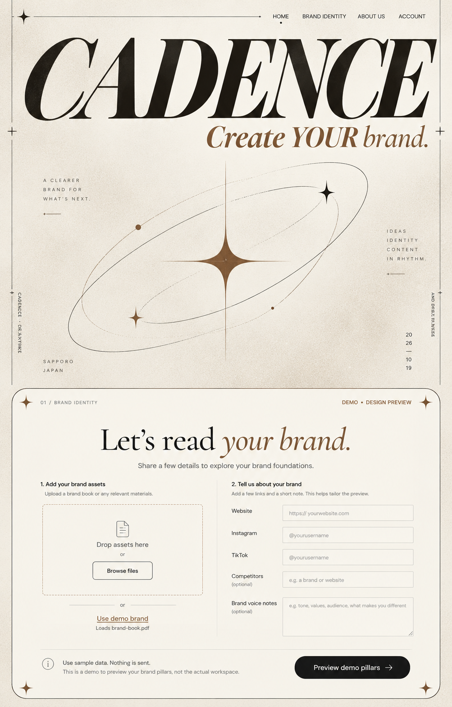
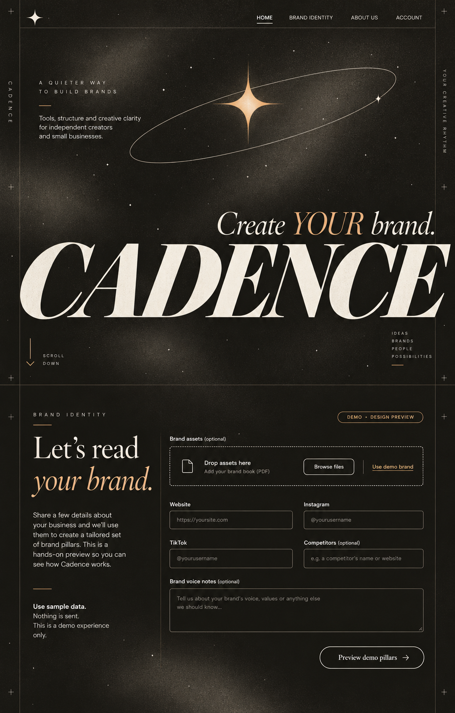
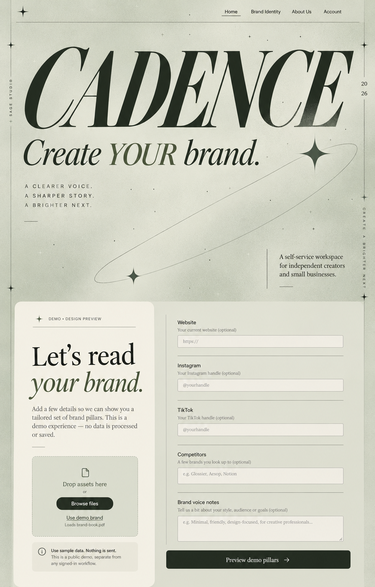

# Cadence — Cream Orbit: review и интерактивный прототип

Дата: 2026-10-19. Ветка `mvp`, baseline `5a71df697fee8fba72eef65364ee87cb28efbc27`.
Первый этап начат с чистого baseline. **Пользователь выбрал1 — Cream Orbit.**

Исследование и три направления сохранены ниже. Выбранное направление реализовано отдельным
React/Vite prototype. [Открыть локальный preview](http://127.0.0.1:4176/) ·
[Workspace](http://127.0.0.1:4176/#workspace/identity) · [отчёт](prototype-report.md).

Рабочие frontend/backend этим slice не менялись. Actual HEAD перед продолжением — `ba39c6a`:
отдельный commit пользователя с pinned GSAP сохранён. Prototype использует собственный lockfile,
не подключает API/Clerk/AI/платежи. Данные synthetic и сбрасываются после reload.
Sites project зарегистрирован private/unpublished; публикация не выполнялась.

## GSAP motion update

В отдельный prototype добавлен GSAP3.15.0 с ScrollTrigger/SplitText/Flip/CustomEase.
[Motion plan, фактические проверки и ограничения](motion-report.md). Рабочий frontend
не менялся; CSS intro≥3s и footer loop сохранены. Sites остаётся unpublished.

Последнее уточнение: контент поднимается снизу через неподвижную маску. На public — один раз
при прокрутке; в Workspace — коротко при открытии. [Реализация и проверки](text-reveal-report.md).

Пользователь принял UI как основу дальнейшей реализации и планирует ручную доработку анимаций
позже. Дополнительная motion polishing не блокирует продолжение. Следующий scope по
[плану](../../ui-rework-plan.md) — backend28, затем перенос shared UI/onboarding/Identity23–24
в существующий Next.js frontend и новые25–27. Этот prototype остаётся synthetic design reference.

## Готовые артефакты выбранного направления

- [Desktop/mobile макеты](design-qa.md#макеты) — landing, Manager, Identity, Strategy,
  Calendar/Post list и Performance; дополнительные tablet captures.
- [Design system](design-system.md) — tokens, typography, components, motion и mobile rules.
- [Navigation map](navigation-and-system.md) и [UI→API mapping](ui-api-mapping.md).
- [Prototype source и команды](prototype/README.md), [backend backlog](backend-backlog.md).
- [Visual QA / Before→After / применённые skills](design-qa.md),
  [browser QA:26 проверок](craft/screens/browser-qa.json).

## Направления в порядке показа

| Выбор | Композиция | Сильная сторона | Компромисс |
| --- | --- | --- | --- |
| **1 — Cream Orbit, рекомендация** | CADENCE на всю ширину сверху, подпись справа, большая орбита; Identity в широкой панели с двумя равными колонками | Ближе к нынешнему тёплому Cadence и типографическому масштабу референса; понятная рабочая форма | Декор и hero требуют отдельной компактной версии в кабинете |
| **2 — Night Signal** | Орбита сверху, логотип у нижнего края hero; Identity с пояснением слева и более плотной формой справа | Самая выразительная тёмная сцена; хорошо разделены история и действие | Зерно и бронзовые линии надо ослабить за таблицами и проверить contrast |
| **3 — Sage Studio** | Асимметричная орбита; в Identity светлая вертикальная панель слева, линейная форма справа | Спокойная studio-атмосфера, сильная структура формы | Сложнее адаптация двух разных колонок к узкому экрану |

Выбор относится к композиции, а не к отказу от остальных тем: Cream/Dark/Sage остаются
предварительными appearance tokens единой будущей системы. Выбор автора: **Cream Orbit**.
Он соединяет желаемую выразительность публичного сайта с читаемостью кабинета.
Финальные typography/spacing/contrast будут проверяться на экранах продукта после выбора.

### 1 — Cream Orbit

### 2 — Night Signal

### 3 — Sage Studio

Это raster exploration: ImageGen не гарантирует точность copy, сетки, размеров шрифта
и accessibility. В Cream осталась нерелевантная подпись **SAPPORO / JAPAN** из reference:
она **отклонена**, не относится к Cadence и должна исчезнуть при уточнении выбранного
макета. В Sage некоторые helper text отображены serif; в реализации body/controls должны
использовать DM Sans. Зерно во всех вариантах нужно значительно приглушить под формами.
Ни один screenshot не согласовывает реальный anonymous upload или обработку данных.

В prompt задан desktop target1440×1600; фактически ImageGen вернул каждый concept
**1003×1568**. Файлы сохранены без растяжения. Детальные1440px/390px browser-макеты выбранного направления теперь доступны в design-qa.md.

## Что находится в пакете

- [Исследование и screenshots](reference-review.md) — наблюдения, навигация, ограничения evidence.
- [Navigation map, сценарии и motion](navigation-and-system.md) — два окна и пять рабочих секций,
  предварительные tokens/components и требования к responsive/accessibility.
- [UI → API и состояния](ui-api-mapping.md) — actual routes, contracts, errors и будущие проверки.
- [Backend backlog](backend-backlog.md) — существующие возможности отдельно от missing scopes.
- [Технический отчёт](review-report.md) — решения, Security Review, verification и оставшаяся работа.
- `api-inventory.json` — механически извлечённые business-controller routes на baseline.
- `generation-prompts.json` — три точных prompt и реально переданные screenshot paths.
- `artifact-manifest.json` — размеры и SHA256 всех изображений для воспроизводимого review.
- `verify_review.py` — локальная проверка docs/artifacts/API drift, без network или secrets.

Исходные [UI rework plan](../../ui-rework-plan.md), [product scope](../../product-scope.md),
[frontend foundation](../../frontend-foundation.md) и [ADR0040](../../adr/0040-frontend-bearer-onboarding.md)
сохраняют API/security boundaries. Свежие read-only #3/#107 остаются OPEN и содержат
исторический remote snapshot; их старые next/status не заменяют local baseline.

## Статус и последующий перенос

Уточнённый raster target и исполняемое представление готовы. Проверены desktop1440,
tablet768 и mobile390/375; screenshot comparison также1487×1058 — размер generated target.
Consent/source staleness, history и отдельные approvals проверены в synthetic model.
Настоящие401/403/409, jobs, uploads, private media/report/export download и late responses
должны повторно квалифицироваться при переносе через существующие API. Mock не закрывает эти gates.

Потом: backend28 → перенос рабочих23–24 →25–27 по плану. Дизайн не закрывает release gates.
