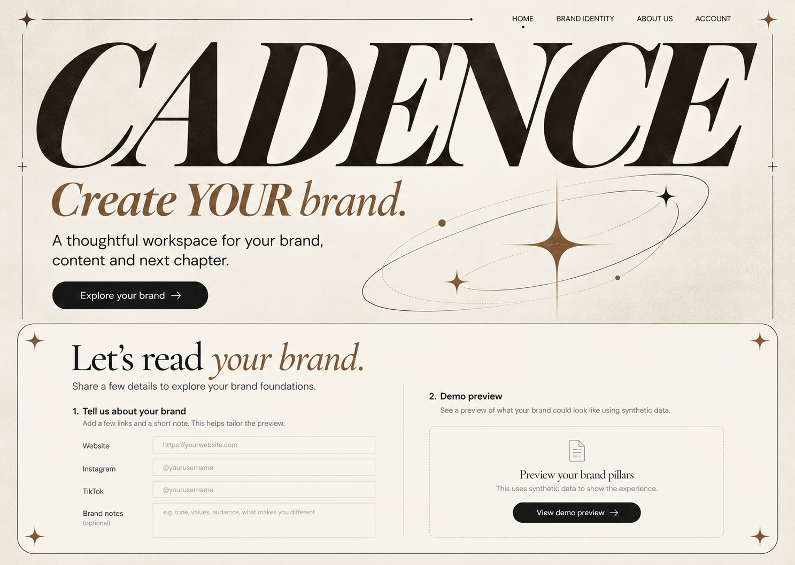
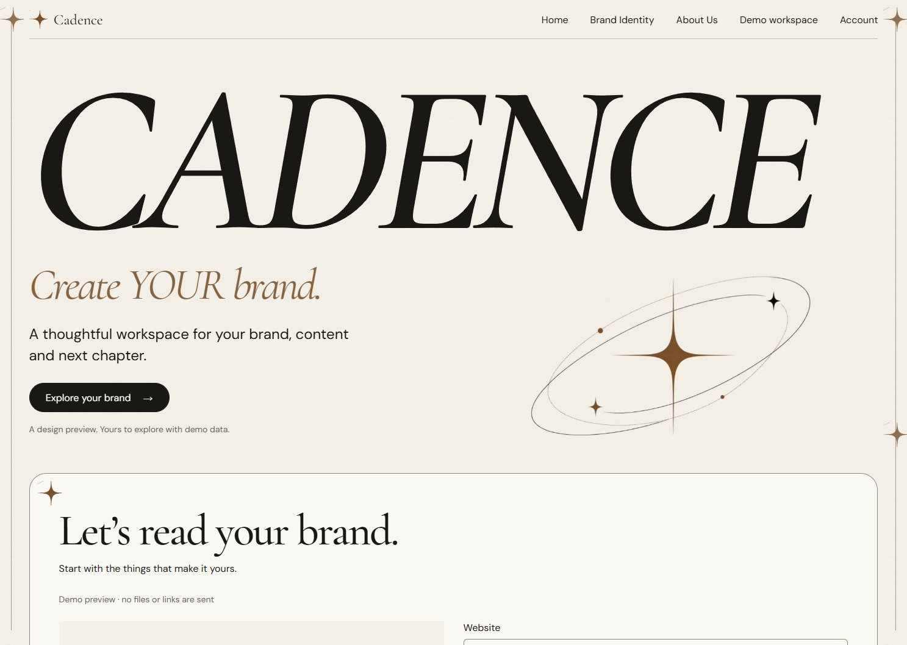

# Cream Orbit — visual QA и решения skills

verdict: **passed** — для отдельного synthetic design prototype в проверенных browser viewports.
Это не production/accessibility certification и не API security qualification.
Открытых P0/P1/P2 visual defects по завершённому review нет; ограничения указаны ниже.

Актуальное продолжение: [GSAP motion report](motion-report.md). Ниже сохранён visual review
с исходными screenshots; новые captures лежат в `craft/motion/`.

## Макеты

Исходный viewport1440×1024 desktop,390×844 mobile; full-page PNG/JPEG длиннее viewport.
Tablet768×1024 и narrow375×812 прошли layout checks. Локальные snapshots созданы реальным
headless Chrome/Edge, разрешённым пользователем; ImageGen используется только для target/artwork.

| Экран | Desktop | Mobile |
| --- | --- | --- |
| Landing / Identity teaser / plans / About |[Макет](craft/screens/desktop-landing.jpg) |[Макет](craft/screens/mobile-landing.jpg) |
| Pillars teaser |[Макет](craft/screens/desktop-pillars.jpg) | Responsive в prototype |
| Workspace Manager |[Макет](craft/screens/desktop-manager.jpg) |[Макет](craft/screens/mobile-manager.jpg) |
| Brand Identity |[Макет](craft/screens/desktop-identity.jpg) |[Макет](craft/screens/mobile-identity.jpg) |
| Strategy |[Макет](craft/screens/desktop-strategy.jpg) |[Макет](craft/screens/mobile-strategy.jpg) |
| Calendar |[Макет](craft/screens/desktop-calendar.jpg) |[Agenda](craft/screens/mobile-content.jpg) |
| Post list |[Макет](craft/screens/desktop-post-list.jpg) | Переключатель в prototype |
| Performance |[Макет](craft/screens/desktop-performance.jpg) |[Макет](craft/screens/mobile-performance.jpg) |

Desktop и mobile captures отражают разные стадии одного demo journey: после recommendation
mobile Strategy может иметь более новую version/goal. Это не inconsistent API response.

## Reference vs actual

Сравнение при одинаковом viewport **1487×1058** (фактический размер generated reference):





Сохранены: oversized serif CADENCE, bronze italic tagline, paper/ink/bronze, орбита,
fixed frame/topbar, широкая Identity panel. Исправлены raster numbering/мелкие labels,
ослаблено зерно, добавлена явная demo маркировка и необходимая Workspace entry.
Лицензированный Cormorant и настоящий16px form дают другую метрику букв, чем ImageGen;
hero выше raster target, чтобы сохранить удобные controls и текст без наложений.
Это задокументированный responsive translation, не заявление о pixel-perfect совпадении.

## Before → After → Why

| Before | After | Why |
| --- | --- | --- |
| Только raster concepts, без исполняемых состояний | Native forms, menu/dialog, synthetic lifecycle и реальные browser screenshots | Проверяем поведение, которое изображение показать не может |
|13 public font sizes на первом implementation pass | Явные role scales; app title28/24, body/input16 | Уменьшает визуальный шум, сохраняет иерархию |
| Desktop hero занимал весь viewport и скрывал Identity | CADENCE увеличен, вертикальная пустота сокращена, Identity начинается раньше | Ближе к выбранной композиции и видим следующий шаг |
| Закрытое mobile menu оставляло измеряемые ссылки | `:not([open]) nav{display:none}`, Escape/click outside | Controls не перекрывают текст и не доступны из закрытого menu |
| Menu стили только≤760, рабочий breakpoint1150 | Общий overlay style для обоих breakpoints | Tablet Sections работает как полноценное меню |
| Второй пост в одном дне попадал в колонку даты | Все posts в mobile agenda явно во второй колонке | Исправлен реальный узкий столбец; browser regression check |
| Consent без истории, риск reuse старой Identity | Ordered Allow/Withdraw history, current source→Identity→Strategy checks | Новое consent не делает старый approved artifact актуальным |
| Prepare content показывал уведомление | Добавляет отдельный synthetic DRAFT с лимитом12 | Control имеет конкретный наблюдаемый результат |
| METRICS были общими для всех Brands | Fixture доступен только своей Brand; чужой scope пуст | Demo не учит смешивать tenant context |
| Pricing: прямая статичная линия | Собственная winding PNG со stars, scroll reveal | Следует reference brief без фотографии на фоне |
| Единственная entrance для pillars | Outgoing curtain + вход pillars; reduced motion immediate | Переход объясняет смену содержимого |

## Применённые skills

| Skill | Что именно изменил |
| --- | --- |
| `design-taste-frontend` | Раздельный public/app draw seed191026; сохранил brand palette/type; крупный logo, спокойный bronze, укороченный desktop hero, ограниченная type scale; browser inspector1440/768/390 и screenshot loop |
| `emil-design-eng` | Контраст действий/disabled states, reusable Field/Button/Modal, native dialog и details, отдельные save/approve, history, scoped empty states, честные notices вместо fake success |
| `mobile-native` |16px inputs,44–48px targets, safe areas,svh/dvh, hover gating, agenda и несколько posts в дне, menu/dialog scroll containment; zoom и выделение текста сохранены |
| `animate` | Выбор motion по назначению: intro3s, transform/opacity curtain, UI180ms/press120ms, scroll line без React render per frame, reduced motion и pause только footer |

Также использованы Sites template/packaging и Product Design reference-to-code QA.
`pick-ui-library` прочитан по указанию animate: задача решена native browser controls;
новые UI/animation dependencies не добавлены. Делегирование не применялось.

## Проверки и исключения

- [Browser scenarios](craft/screens/browser-qa.json):26 PASS,0 FAIL; state/scopes, consent,
  approvals, Calendar, report preview,375/390/768 layouts, keyboard Escape, reduced motion.
- [Public inspector](craft/inspect-landing/report.json):0 FAIL,2 WARN.
- [App inspector](craft/inspect-app/report.json):0 FAIL,4 WARN.
- [Source lint](craft/source-lint.json):0 FAIL,7 WARN после узких комментариев с причинами.
- Console errors0; application HTTP requests только loopback; persistent storage/cookies0.
  Inline `data:` icons native date/time controls исключены из HTTP network assertion.

`inspect-preview.mjs` ждёт3600ms после navigation, не отключая intro и не меняя skill.
Иначе обязательный3s экран загрузки даёт ложные empty/covered findings.
`late-title` разрешён только из-за прямого требования intro; `hairline`, cream/bronze,
`few-pictures`/`no-footage`, `name-only-title` — из-за заданного frame, палитры,
CADENCE wordmark и отсутствия фоновых photos в brief. Случайные rule exceptions не добавлялись.

Public WARN: outlined Identity curtain сохранён по brief; still-page не лечится бессмысленными
декоративными движениями. App WARN: native date/time bounding boxes (`ragged-row`), высота
недельного Calendar (`panel-void`), спокойный bronze выбранного дня (`no-data-hue`) и outline
интерактивного selected post (`heavy-borders`). Эти сигналы проверены по screenshots;
содержимое не обрезано, controls доступны. Lint-ignore относится только к запрошенной рамке,
табличным boundaries и настоящим overlay shadows; каждый содержит причину на той же строке.

## Critique rounds

```text
ROUND 1
Seen in one second: CADENCE, но desktop hero слишком высокий.
Idea (one sentence): От голоса бренда к ритму контента через одну cream studio оболочку.
Live thing: Pillar preview и demo Workspace с отдельными решениями review/approval.
Layout words by section: hero=split / Identity=form / plans=paired / About=statement / footer=wordmark
Scores: design 7 · usability 7 · creativity 7 · content 8 → overall 7.1
Caps applied: 6.0 — исходный inspector видел закрытое mobile menu и UI wrapper.
Top three fixes: исправить mobile menu; уплотнить hero; проверить реальные Calendar edge cases.

ROUND 2
Seen in one second: Большой CADENCE, bronze orbit и следующий шаг Brand Identity.
Idea (one sentence): Просмотренные источники становятся последовательным контентным ритмом.
Live thing: Synthetic consent → Identity → Strategy → content → recommendation → новый DRAFT.
Layout words by section: hero=split / Identity=curtain / plans=paired / About=statement / footer=marquee
Scores: design 7 · usability 8 · creativity 7 · content 8 → overall 7.4
Caps applied: 6.5 — house rubric ограничивает score за hairlines и менее четырёх photos;
они сознательно сохранены по пользовательскому brief. still-page ограничивает design до7.
Top three fixes: реальный phone QA; квалификация всех auth/API states при переносе;
production contrast/accessibility qualification тем Dark/Sage.
```

Scores — инженерная visual critique, не независимая оценка. Итоговый house score≤6.5;
он не скрыт и не повышен для получения pass. `passed` относится к scope prototype QA,
в котором обязательные brand features имеют приоритет над общими house preferences.
