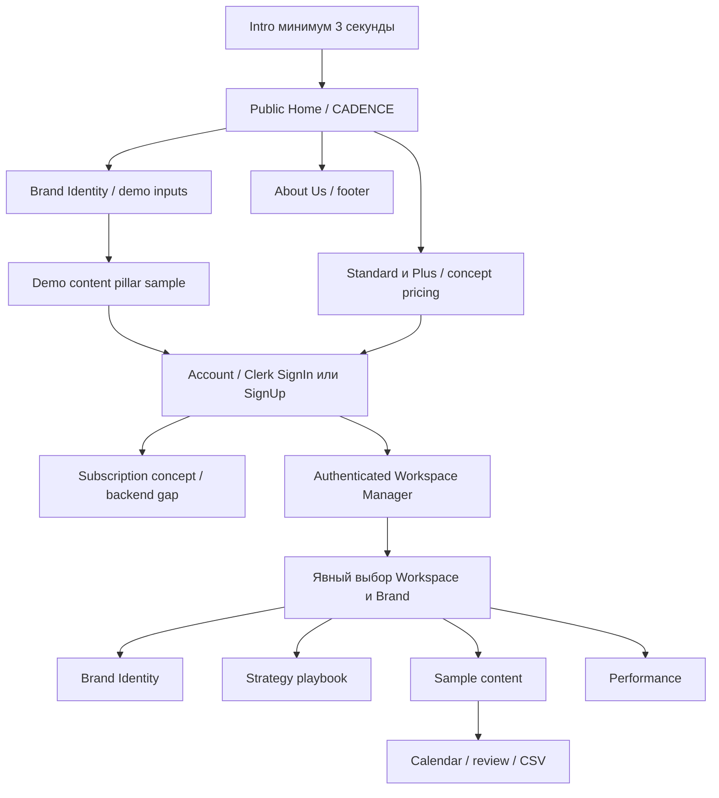

# Navigation map, сценарии и предварительная система

## Working navigation2026-10-20

Cream Orbit rework23–24 перенесён: `/`, `/sign-in/`, `/sign-up/`, `/workspaces/`.
В кабинете `#manager`/`#identity` с browser Back, Workspace menu и bounded Brand selector;
нет private IDs/tokens в URL. Scope выбирается отдельно и заново проверяется actual API.
Manager содержит existing create/list/read workflows, Identity — registration/review/Jobs/
DRAFT/edit/separate approval/history/withdrawal. Strategy/Content/Performance явно disabled,
availability disclosure объясняет later25–27. Empty/unavailable/conflict states настоящие.
Public Account — Clerk, без demo login/plan gate. Public source panel информационная;
anonymous analysis/billing не реализованы. Дополнительная intro/text/scroll motion polishing
отложена, основной settled layout сохранён. [Отчёт](../../ui-rework23-24-report.md).
Ниже сохранена исходная карта design prototype; demo paths/timings не являются working API.

Статус: Cream Orbit выбран пользователем,2026-10-19. Ниже сохранён contract будущего
production flow; исполняемая demo-оболочка и tokens описаны в [design system](design-system.md).
Все prototype screens/values явно DEMO; authentication/API не подключены.

## Два окна, общая оболочка

«Окно» интерпретируется как две поверхности сайта с собственными routes; browser popups
не нужны. В обоих случаях общий fixed background, topbar и edge ornaments. Декоративные
слои `aria-hidden`, не получают focus и не перекрывают pointer events.

FutureBilling — демонстрация запрошенного пути, **не обязательный access gate действующего
MVP**. Backend billing отсутствует; auth не превращает выбранный клиентом plan в entitlement.
В prototype есть ясное действие «Continue demo», без оплаты и ложного статуса подписки.

## Окно1: public

Topbar: Home → самый верх/CADENCE; Brand Identity → demo panel; About Us → финальный текст;
Account → Clerk entry; Workspace виден после sign-in и ведёт в окно2. В demo будет отдельный
«Open demo workspace», который не имитирует настоящий login. Не собирать пароль в custom form.

Порядок секций и действий:

1. **Intro**: ≥3s один раз при входе. Не повторять на tab/Workspace/Brand switches.
2. **CADENCE / Create YOUR brand.**: анимированное появление; фон/обёртка/topbar фиксированы.
3. **Brand Identity / Let's read your brand.**: upload area, website, Instagram, TikTok,
   competitors, voice notes — содержательная структура Step1Upload. Public demo работает
   только с поставленными synthetic fixtures; никакие введённые bytes/URLs не уходят наружу.
4. **Content pillar sample**: явное Preview demo pillars расширяет панель, как ширму, и
   открывает только pillars, их описания/веса/форматы. Нет выдуманного competitive research,
   full Strategy, approval или measured audience signals. Пример весов синтетический.
5. **Strategy playbook →**: ведёт в Account entry, затем concept subscription screen.
   Для уже вошедшего пользователя — workspace/Brand context и actual Strategy prerequisites.
6. **Standard / Plus**: две колонки, движущаяся линия со звёздами без фото. Цена «TBD» и
   маркировка Concept plans; цены/лимиты/период/налоги не установлены. Не выдумывать £19/£49
   и не обещать capability, которой нет у qualified providers.
7. **About Us**: короткая цель Cadence и разработчиков, затем собственная анимированная полоса.

Нужно воспроизвести последовательность reference, но input нельзя прятать за scroll-only
анимацией, стирать при reveal или подменять ответы timer-ом. Browser Back возвращает состояние
навигации, а не извлекает private data из public cache.

## Окно2: кабинет

Topbar: **Home | Selected Workspace › | Brand Identity | Strategy playbook | Sample content |
Performance**. Справа — отдельный Account control, не новая бизнес-секция. Workspace chevron
поворачивается вниз и раскрывает list + Create workspace + Manage workspaces. Кнопка имеет
`aria-expanded`, поддерживает Escape и возврат focus. Workspace list bounded/paginated.

Ровно пять основных views: **Workspace Manager, Brand Identity, Strategy playbook, Sample
content, Performance**. Performance сохранён несмотря на его пропуск в последнем перечне
brief. Новый Calendar не становится шестой основной секцией: это view внутри Sample content.

Один Workspace содержит несколько Brands. Под topbar — компактный Brand switcher с названием
и статусом выбранного Brand; он обязателен на всех Brand-scoped views. До выбора Brand экран
объясняет следующий шаг. Переключение Workspace очищает Brand, формы и prior request state.

| View | Основное действие | Вложенные views |
| --- | --- | --- |
| Workspace Manager | Create/select workspace | Rename/industry, Brand list/create/edit, archive с expectedVersion |
| Brand Identity | Добавить source и явно review/consent | Sources, exact snapshot, history/withdrawal, Jobs, DRAFT editor, отдельное approval |
| Strategy playbook | Generate DRAFT from approved Identity | Goals/audience/pillars/tone/cadence/channel mix/whitespace/4-week outline, history/approval |
| Sample content | Generate reviewable content | Posts, revision editor, review/media, Calendar, schedule history, CSV export Job/download |
| Performance | Import metrics и читать coverage | KPI/charts, attribution, evidence-linked recommendations, apply→DRAFT, private reports |

История/approval могут открываться в drawer или nested route. Они не добавляются как
всегда видимый шестой/седьмой dashboard. Изменение APPROVED создаёт новый DRAFT.

## Motion contract

| Событие | Предложение | Ограничение |
| --- | --- | --- |
| Вход |3000ms intro, финальный reveal400–700ms | assets failure: bounded timeout и recovery; без звука |
| Hero | transform/opacity, stagger60–100ms | текст доступен без JS; reduced motion сразу settled |
| Identity entry | мягкое раскрытие панели по scroll | не блокирует поля/focus, не запускает API |
| Preview pillars | расширение300–600ms после явного demo action | не означает сохранение, consent или Job success |
| Standard/Plus | line progression по scroll, stars появляются у checkpoints | текст не меняет смысл и остаётся доступным |
| Workspace chevron | rotate90deg120–180ms | nav мгновенная, без cinematic loader |
| Footer strip | медленная повторяемая полоса | pause control и static reduced-motion version |

Это предложенные timings, не измеренные значения reference. Не использовать scroll hijack,
drag-only controls, мигание или animation, пересекающую рабочие формы. В product data grids
фон под данными спокойный; grain/орбита остаются по краям. Motion prototype проверяется позже.

## Предварительные tokens и компоненты

Сохраняются имеющиеся self-hosted Cormorant Garamond + DM Sans и OFL notices. Новые CDN/fonts
не добавляются. Mono fallback system используется только для version/timestamps, при
необходимости можно сохранить максимум две визуальные font families для основных controls.

| Token | Cream | Dark | Sage |
| --- | --- | --- | --- |
| stage | `#d9d3c5` | `#0f0e0c` | `#d3d7ca` |
| paper | `#f3f0e8` | `#191612` | `#f2eee4` |
| raised paper | `#faf8f2` | `#24201a` | `#faf7ee` |
| ink | `#1a1814` | `#ece8df` | `#20291f` |
| muted | `#686157` | `#bcb2a2` | `#5d6657` |
| accent | `#86623e` | `#d7a878` | `#4b6850` |
| focus | `#835227` | `#f2bd74` | `#3d633f` |

Это actual current CSS tokens, а raster variants — интерпретация. Новая рабочая сетка:
4/8/12/16/24/32/48/64/96px; body16px, labels14px, supporting text≥12px без critical copy;
рабочий h132–48px, public logo fluid до220px. Controls min44×44px. Forms line length≤65ch.
Final borders/contrast/scale требуют измерения на chosen layout.

Shared components будущего прототипа: FixedShell, PublicNav, WorkspaceNav, WorkspaceSwitcher,
BrandContext, DemoNotice, Intro, IdentitySourceForm, ReviewSnapshot, ConsentAction,
JobStatus, VersionLabel, ApprovalAction, HistoryDrawer, ConflictNotice, EmptyState,
UnavailableState, PillarList, RevisionEditor, CalendarGrid+Agenda, MetricSummary,
RecommendationEvidence, PrivateDownloadAction, PlanComparison, FooterStrip.

ConsentAction и ApprovalAction остаются разными controls со своими server contracts.
System details (checksum/source IDs) — в раскрываемом verification view; сам reviewed text,
scope согласия, version, deadline/withdrawal consequences и status не скрываются.

## Responsive и accessibility acceptance после выбора

- Desktop1440: рабочая max-width1280, фиксированные края24–32px. Topbar не перекрывает h1.
- Mobile390/375: края8–12px, одноколоночные forms/plans; public nav в Menu, workspace/Brand
  selectors всегда доступны, пять sections в accessible menu. Никаких horizontal page overflow.
- Calendar: desktop grid → mobile agenda; date/timezone и DST choice остаются явными.
- Sidepanel превращается в dialog/full-height sheet с focus trap, Escape и focus return.
- Semantic headings/landmarks, skip link, active nav через `aria-current`, реальные labels.
- WCAG contrast цель4.5:1 text/3:1 крупный text и nontext controls; измерить, не выводить по image.
- Keyboard/reduced-motion/zoom200%/axe и screen-reader smoke; декор не имеет reading order.
- В каждом разделе: loading, empty, errors401/403/404/409, provider unavailable, uncertain
  mutation result и recovery. Цвет не единственный способ различать DRAFT/APPROVED/expired.

## Фактические prototype routes

Public: `#home`, `#brand-identity`, `#plans`, `#about`. Account открывает native dialog,
Continue demo journey → Choose a plan concept → Manager. Видимая Demo workspace entry
не имитирует authenticated session. Home link кабинета — Cadence mark слева.

Workspace: `#workspace/manager`, `#workspace/identity`, `#workspace/strategy`,
`#workspace/content`, `#workspace/performance`. В DOM ровно одна рабочая секция.
Manager открывается из Workspace menu; Calendar/Post list — два представления Sample content.
Brand выбирается отдельно и не извлекается из недоверенного route. Mobile Sections заменяет
длинный topbar, Escape закрывает menu. Intro повторяется только после reload, не при switch.

Схема выше показывает целевой authenticated flow; в prototype Clerk/платёжные стрелки —
явные preview concepts. Нет false login, paid status или anonymous analysis настоящих данных.
