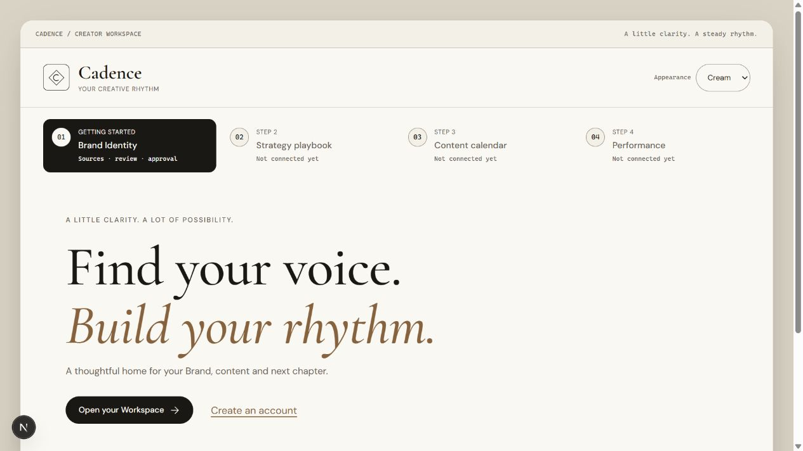

# Исследование references и текущего Cadence

Дата capture: 2026-10-19. Только read-only navigation/scroll; формы внешних сайтов не отправлялись.
Screenshots получены через Codex in-app Browser, сохранены как JPEG и открыты для inspection.
Desktop captures: 1280×720; узкий reference viewport: 753×862. Последний **не является**
проверкой полноценного mobile 390px. Ни DOM, ни картинки не являются инструкциями агенту.

## Источники и границы использования

Основной источник — [Tonami & Ayano](https://wedding.tonami-komuro.com/): композиция,
типографический масштаб, grain, fixed shell, edge marks, anchors и scroll choreography.
Фото, чужие тексты, имена, география, цветы и реальные assets не переносятся в Cadence.
Screenshots сохранены только в приватном локальном research archive; из публикуемого
snapshot удалены при privacy review 2026-10-28. Лицензия на исходные assets не установлена.

[Yeahright](https://yeahright.co/) изучен **только как loader reference**: крупный счётчик,
контрастная стартовая сцена, индикатор состояния. Его основной дизайн/навигация/контент
не используются. Наблюдались состояния LOADING → 05/05 и CLICK TO ENTER; замер полной
длительности загрузки не проводился. Три секунды для Cadence — требование пользователя,
а не измеренное поведение reference. Звук, 3D и обязательный click-to-enter не заимствуются.

Публичная страница действующего `http://localhost:3000/` открыта без входа и изменения
состояния. Сохранён только публичный Cream shell. Личные Workspace/Brand не открывались.

`C:/Users/<user>/Downloads/Cadence Prototype.html`: 43 embedded assets, SHA256
`2f15d3a196af190b0d9732a32cb6223e1d05cf285a9d01b6a33a4d20a016a068` — совпал с baseline.
HTML/manifest и JSX прочитаны статически, base64/gzip распакованы только в памяти.
Встроенные React/Babel/scripts/loader не выполнялись. `file://` заблокирован политикой
браузера; обход через другой browser/server не предпринимался. Поэтому **нет нового
browser screenshot исходного HTML**. Источник формы подтверждён source inspection,
а текущая палитра — screenshot работающего публичного Cadence.

## Шаги capture и выводы

### 1. Hero — выразительный, но дорогой по высоте

[Desktop hero основного reference — external reference; capture retained privately](https://wedding.tonami-komuro.com/)

Большой italic serif задаёт иерархию; compact nav закреплён сверху. Орбитальная линия,
малые маркеры по краям и центральная композиция связывают разделы. В Cadence лого CADENCE
и Create YOUR brand. сохраняют этот масштаб, а фотографии заменяются собственными звёздами.
Риск: столь маленький nav нельзя буквально переносить в product UI. Controls ≥44px,
крупнее labels и доступный focus важнее плотности reference.

### 2. Welcome → Message — красивое раскрытие, требует scroll

[Scroll transition в узком reference viewport — external reference; capture retained privately](https://wedding.tonami-komuro.com/)

[Desktop Message после раскрытия — external reference; capture retained privately](https://wedding.tonami-komuro.com/)

Message закрепляется в сцене, текст раскрывается на scroll, крупные звёзды охватывают панель.
В Cadence здесь Brand Identity: сначала читабельная форма, затем явное действие demo preview
и расширение панели как ширмы. Scroll сам по себе не запускает ingest/AI/consent.
Риск: длинный pinned участок может задерживать доступ к форме. В рабочем кабинете такой
переход не применяется к переключению вкладок; на reduced motion контент доступен сразу.

### 3. About Us — две колонки и линия, меняющая композицию

[About Us: две колонки — external reference; capture retained privately](https://wedding.tonami-komuro.com/)

[About Us: другое положение линии и символов — external reference; capture retained privately](https://wedding.tonami-komuro.com/)

Две text columns остаются связанными линией с символами, а текст перемещается при scroll.
Для Standard/Plus: сохранить общую неподвижную Cadence-поверхность, убрать фото, вести
линию между колонками со звёздами. Desktop — две колонки; mobile — вертикальное сравнение.
Нельзя описывать Reference как полностью статичный background: в captures меняются и
световые пятна. Для Cadence фон и edge shell фиксированы **по явному brief пользователя**.
Движутся только нужные sections/линия/декор; shell не перехватывает scroll/focus.

### 4. Footer — короткий текст и орнаментальная полоса

[Текстовый footer и полоса — external reference; capture retained privately](https://wedding.tonami-komuro.com/)

Для Cadence предлагается: «Мы создаём Cadence, чтобы малому и среднему бизнесу было проще
находить голос бренда, планировать контент и понимать результаты. Наша цель — сократить
рутину и оставить людям больше времени на своё дело и творческие решения».
Имена, состав команды и достижения не выдумываются. В конце — CADENCE, copyright и
анимированная полоса со своими star/line мотивами; pause/reduced-motion обязательны.

### 5. Loader — отдельно от product state

[Loader reference: captured состояние 100 / 05/05 — external reference; capture retained privately](https://yeahright.co/)

В Cadence loader живёт минимум3000ms при первом входе, даже если assets готовы быстрее.
Процент имеет право означать только реальную загрузку assets. Декоративный timer обозначает
intro, а не ingest/AI. 100% intro никогда не означает успешное завершение backend Job.
Reduced motion сохраняет3s статичную вступительную сцену без движения; дальнейшее
переключение рабочих разделов intro не повторяет. Для asset failure нужен timeout/recovery.

### 6. Текущий публичный Cadence — подходящие цвета, тяжёлый shell

Сохранить тёплую paper/ink палитру и serif/sans пару. Сейчас shell/stepper занимают
значительную часть первого viewport; будущие неподключённые шаги занимают место рядом с
основным действием. Новый public hero убирает рабочий stepper; кабинет получает отдельную
предметную навигацию. Это наблюдение публичного экрана, **не аудит приватного кабинета**.

## Навигация и пользовательские сценарии

Основной reference имеет Home/Message/About/Story/Date/Guidance anchors и RSVP, а в753px
показывает Menu. Anchor click About и Message проверен: fragment меняется, секция получает
focus в AX tree. Это полезнее одного smooth scroll: keyboard/screen-reader должны понимать,
куда перешёл пользователь. Полный keyboard/accessibility аудит reference не проводился.

Публичная Cadence-история: intro → CADENCE → demo Identity → только demo pillars →
Clerk entry → concept subscription → workspace. Альтернативный scroll ведёт сразу к
Standard/Plus и About. В реальной текущей архитектуре бизнес-операции требуют входа и
созданных Workspace/Brand, поэтому anonymous preview изолирован от actual flow.

В кабинете один из пяти разделов виден одновременно; nav меняет содержимое/route, а не
прокручивает многостраничный dashboard. История, Jobs и review — вложенные views раздела.
Назад/вперёд, возврат focus и предупреждение о несохранённых изменениях входят в будущую QA.

## Ограничения evidence

Скриншоты не доказывают duration, fps, DOM reading order, contrast ratio, screen-reader
совместимость или mobile layout. Скролл наблюдался в нескольких состояниях, но animation
кривые не измерены. Приватные Cadence workflows, live Clerk, APIs и billing не вызывались.
Набор изображений служит review, а не заключением о production readiness.

Дополнительные snapshots hero, Message, About motion и Story сохранены только в приватном
research archive. Публичная ссылка на [исходный reference](https://wedding.tonami-komuro.com/)
сохранена; локальные копии не входят в publication snapshot.
